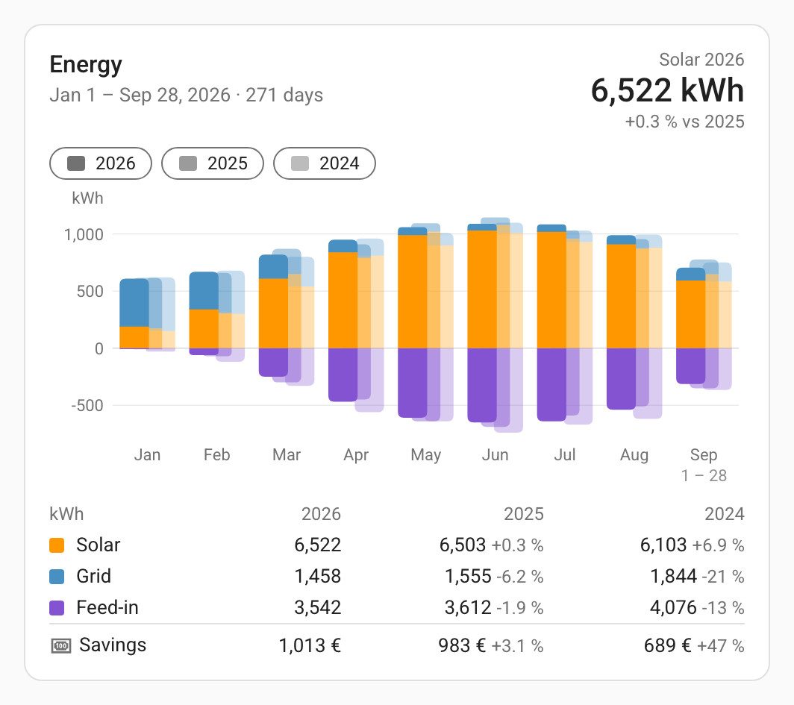
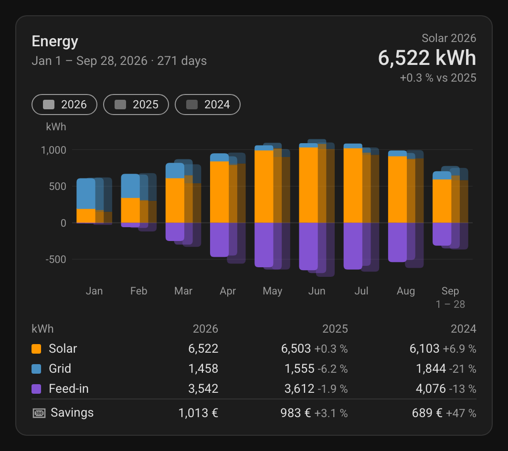
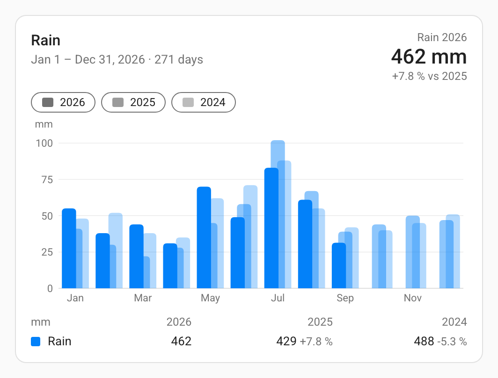
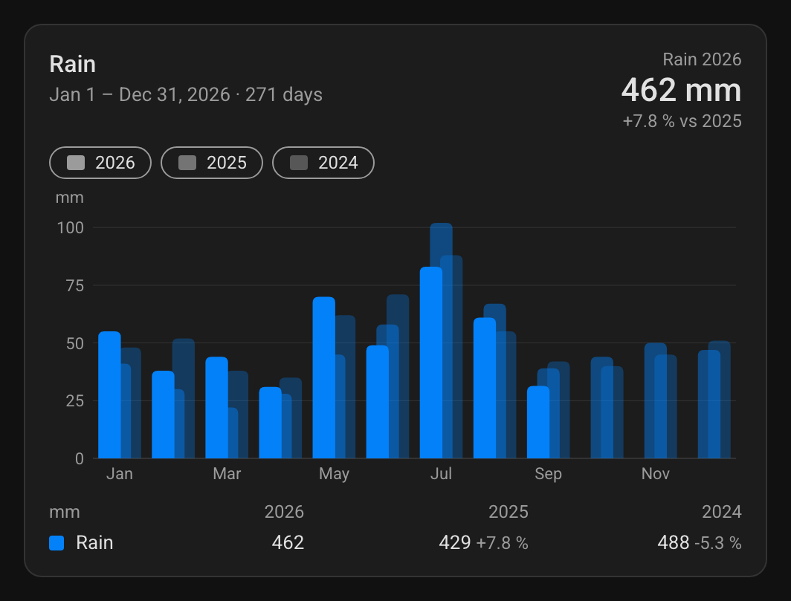

# ha-comparison-card

A Home Assistant Lovelace card that compares a date range of this year with the same range of
previous years.

- The current year is drawn as **stacked bars** from long-term statistics.
- Previous years stand behind it as **ghost bars**: the same segments in the same colors,
  translucent and offset, each year one step further back – or **side by side**, all years fully
  visible.
- A **value table** lists the totals per year with the change against the current year.
- **Calculated rows** add your own figures (consumption, self-sufficiency, costs, …) from Jinja2
  templates.

One JavaScript file, no dependencies, with a visual editor.

| Light | Dark |
|---|---|
|  |  |
|  |  |

*Screenshots with invented data. The configurations are the first two [examples](#examples).*

## Features

- One bar per **hour, day or month** over any date range, also across New Year (e.g. a heating
  season from October to March).
- **Every year over the same range:** calendar days line up across years. With a rolling end
  (today or yesterday) previous years stop at the same calendar day; with a fixed last day every
  previous year counts its whole range. Leap days only count where they exist.
- **Several statistics per series** are summed up, e.g. three inverters as one "Solar" series.
  Statistics are used directly, so a replaced or deleted device keeps its history.
- **Value templates** turn a series into a formula of other series, e.g. solar used at home =
  production minus feed-in. They are evaluated in the browser and cost Home Assistant nothing.
- Up to **five previous years**, as ghost bars with an opacity per year or side by side. Chips in
  the card show or hide single years.
- **Missing data** is detected per day. Years with gaps are marked with `*` and get no percentage.
- Tooltip per bar, theme colors, number and date format of your Home Assistant language.

## Installation

1. Copy `ha-comparison-card.js` to `/config/www/ha-comparison-card/`.
2. Add it as a dashboard resource (*Settings → Dashboards → ⋮ → Resources*):
   URL `/local/ha-comparison-card/ha-comparison-card.js`, type *JavaScript module*.
3. Reload the browser and add the card *Comparison Card* to a dashboard.

## Configuration

| Key | Default | Description |
|---|---|---|
| `title` | – | Card title |
| `start` | `01-01` | First day of the range (`MM-DD`) |
| `end` | today | Last day: `MM-DD`, `today` or `yesterday` (see [Date range](#date-range)) |
| `group_by` | `month` | One bar per `hour`, `day` or `month` |
| `compare_years` | `[1]` | Previous years as years back (1 = last year, up to 5) |
| `layout` | `behind` | How the years of one bar are arranged: `behind` – previous years as translucent ghost bars behind the current one; `side_by_side` – one fully visible, narrower bar per year, oldest left, 1 px apart |
| `ghost_opacity` | 45, 30, 20, 13, 8 % | Opacity per years back, e.g. `{1: 50, 2: 25}` (percent, or fractions up to 1). Only with `layout: behind` |
| `series` | – | Bars and table lines, see [Series](#series) |
| `rows` | – | Calculated rows, see [Calculated rows](#calculated-rows) |
| `headline` | – | Name of a series or row shown large in the header, with the change against the first compared year |
| `show_table` | `true` | Show the value table |
| `stat_type` | `auto` | `change` (meters), `mean`, `min` or `max`. Auto: `change` for statistics with a sum, `mean` otherwise |
| `unit` | from statistic | Display unit; converts within the unit class (Wh/kWh/MWh, …) |
| `decimals` | automatic | Decimals of the series values |
| `chart_height` | `200` | Chart height in px |

### Series

The order of the series is the stacking order from the zero line and the order of the table lines.

| Key | Description |
|---|---|
| `name` | Label in the table and tooltip |
| `statistics` | One or more statistic IDs (entity IDs or external statistics); their values are summed up |
| `template` | Value template instead of the plain sum, e.g. `{{ solar - feed_in }}` (see [Value templates](#value-templates-for-series)) |
| `id` | Template variable name. Default: derived from the name (`Grid import` → `grid_import`; `ä` → `ae`, `é` → `e`) |
| `color` | Any CSS color; default from a fixed palette |
| `below_zero` | Draw this series below the zero line, e.g. feed-in. Display only, nothing is subtracted |

### Calculated rows

| Key | Description |
|---|---|
| `name` | Label |
| `icon` | Icon in front of the label, default `mdi:function-variant` |
| `template` | Jinja2 template, rendered once per year |
| `unit` | Unit shown after the value (default: unit of the statistics) |
| `decimals` | Decimals |

## Date range

| `end` | Range | Today |
|---|---|---|
| empty / `today` | first day … today, moves on every day | included, refreshed every 10 minutes |
| `yesterday` | first day … yesterday, moves on every day | not included (whole days only) |
| `MM-DD` | fixed, e.g. `01-01` … `12-31` | included while the range lasts |

- A last day before the first day spans the turn of the year (`start: "10-01"`, `end: "03-31"`).
- The current range is the latest one that has begun. On 1 January a range starting `01-01`
  shows the new year.
- The value table sums every year over its own range: the current year up to today or yesterday,
  previous years up to their last day. With a rolling end that is the same calendar day as today;
  with a fixed last day (e.g. `12-31`) it is the whole range, so the table shows how much of the
  previous years has been reached so far.

## Value templates for series

By default a series is the sum of its statistics. With `template` its value is a formula instead,
calculated for every day (or hour) and year, before the days are added up to bars and totals:

```yaml
series:
  - name: Solar used at home
    statistics: [sensor.inverter_1_energy, sensor.inverter_2_energy]
    template: "{{ solar_used_at_home - feed_in }}"
  - name: Feed-in
    statistics: [sensor.grid_export_energy]
    below_zero: true
```

- Inside a value template every series stands for the **sum of its statistics** on that day,
  under its template variable. A series may use its own sum, as above, or only other series and
  have no statistics at all.
- Everywhere else – bars, value table, headline and calculated rows – a series stands for its
  **displayed value**, i.e. the template result.
- A series without a value on a day counts as `0` for meters. For `mean`, `min` and `max` the day
  is left out.
- Value templates run in the browser, because a bar chart needs hundreds of values and Home
  Assistant would have to render each one. They understand the expression part of Jinja2:
  numbers, the series variables and `series['name']`, `+ - * / // % **`, comparisons,
  `and or not`, `a if condition else b`, lists, and `max min abs round float int sum default`
  as functions or filters (`max(solar, 0)`, `[a, b] | max`, `x | round(1)`).
- Not supported: `states()` and other Home Assistant functions, `` blocks. An error is shown
  below the card, e.g. `Solar: Unknown variable feed`.

## Writing templates for calculated rows

Each calculated row is a normal Home Assistant template. It is rendered once per year column,
and every series is available as a variable holding its **total for that year**:

- the template variable of each series, shown in the editor next to the series (e.g. `{{ grid }}`)
- `series['grid']` – the same values as a dict
- `days` – number of days summed up, `year`, `label` (e.g. `2025` or `2025/26`), `current` (true
  for the current year)

Examples for series named *Grid*, *Solar* and *Feed-in* (variables `grid`, `solar`, `feed_in`):

| Row | Template | Unit | Decimals |
|---|---|---|---|
| Consumption | `{{ grid + solar - feed_in }}` | | |
| Solar used at home | `{{ solar - feed_in }}` | | |
| Self-sufficiency | `{{ (solar - feed_in) / (grid + solar - feed_in) * 100 }}` | `%` | `0` |
| Self-consumption rate | `{{ (solar - feed_in) / solar * 100 if solar else none }}` | `%` | `0` |
| Consumption per day | `{{ (grid + solar - feed_in) / days }}` | `kWh/day` | `1` |
| Grid cost | `{{ grid * states('input_number.electricity_price') \| float(0) }}` | `€` | `2` |

Tips:

- **Return only the number.** Put the unit and decimals into the fields of the row; the card
  formats the value and compares it with the other years.
- **Missing data:** a series without any value in a year is `none`, and `{{ grid + solar }}` then
  fails (the cell shows ⚠, hover for the error). Use `{{ (grid or 0) + (solar or 0) }}`.
- **Division:** guard against zero with `… if solar else none`; the cell then shows "–".
- **Entities** can be used as well, e.g. a price with `states('…') | float(0)`. The row updates
  when the entity changes.
- **A value per year,** e.g. the electricity price of each year: look it up by `year` in a dict,
  with a fallback for all other years. Unlike an entity, which only knows today's price, this
  keeps the previous years right:

  ```
  
  {{ solar * price }}
  ```

  `year` is the first year of the column (`2025` for `2025/26`). A price change within a year
  cannot be expressed this way, because a row only sees the totals of the year.
- **Text** results are shown as they are, without comparison:
  `{{ 'record' if solar > 1000 else 'normal' }}`.

## Examples

Energy up to today with two previous years: three inverters as one series, feed-in below the zero
line and the savings from the solar power used at home as a calculated row (first screenshot):

```yaml
type: custom:ha-comparison-card
title: Energy
compare_years: [1, 2]
series:
  - name: Solar
    statistics: [sensor.inverter_1_energy, sensor.inverter_2_energy, sensor.inverter_3_energy]
    color: "#ff9800"
  - name: Grid
    statistics: [sensor.grid_import_energy]
    color: "#488fc2"
  - name: Feed-in
    statistics: [sensor.grid_export_energy]
    color: "#8353d1"
    below_zero: true
rows:
  - name: Savings
    icon: mdi:cash-100
    template: "{{ (solar - feed_in) * 0.34 }}"
    unit: €
    decimals: 0
headline: Solar
```

Rain per month for the whole year with two previous years; the current month and today are
included, previous years are drawn and summed up to December (second screenshot):

```yaml
type: custom:ha-comparison-card
title: Rain
end: "12-31"
compare_years: [1, 2]
series:
  - name: Rain
    statistics: [sensor.weather_station_total_rain]
    color: "#0381F9"
headline: Rain
```

Energy with the solar power used at home instead of the production. Solar used at home plus grid
is the consumption, so the bars above the zero line show it directly and the savings are simply
the solar value times the price:

```yaml
type: custom:ha-comparison-card
title: Energy
compare_years: [1, 2]
series:
  - name: Solar
    statistics: [sensor.inverter_1_energy, sensor.inverter_2_energy, sensor.inverter_3_energy]
    template: "{{ solar - feed_in }}"
    color: "#ff9800"
  - name: Grid
    statistics: [sensor.grid_import_energy]
    color: "#488fc2"
  - name: Feed-in
    statistics: [sensor.grid_export_energy]
    color: "#8353d1"
    below_zero: true
rows:
  - name: Consumption
    icon: mdi:home-lightning-bolt
    template: "{{ solar + grid }}"
  - name: Savings
    icon: mdi:cash-100
    template: "{{ solar * 0.34 }}"
    unit: €
    decimals: 0
headline: Solar
```

Heating season per month, three seasons back, the seasons side by side instead of ghost bars
(`layout: side_by_side`):

```yaml
type: custom:ha-comparison-card
title: Heating
start: "10-01"
end: "03-31"
compare_years: [1, 2, 3]
layout: side_by_side
series:
  - name: Gas
    statistics: [sensor.gas_meter]
```

December per day, with the daily costs:

```yaml
type: custom:ha-comparison-card
title: December
start: "12-01"
end: "12-31"
group_by: day
series:
  - name: Grid
    statistics: [sensor.grid_import_energy]
rows:
  - name: Cost
    icon: mdi:currency-eur
    template: "{{ grid * 0.32 }}"
    unit: €
    decimals: 2
```

## Visual editor

- **General:** title, first and last day, one bar per hour/day/month, statistic type.
- **Compare with:** behind or side by side, then one line per previous year – switch plus
  opacity in percent (locked when side by side).
- **Bars:** one collapsible box per series (name, statistics, value template, template variable,
  below zero, color), move up/down, remove.
- **Value table:** switch for the table and the calculated rows (name, icon, template, unit,
  decimals).
- **Display** (collapsible): chart height, headline value, unit, decimals.

## How it works

- Data comes from `recorder/statistics_during_period` with `period: day` (or `hour`), one request
  per year. The recorder rounds the end of a request up to a whole period, so a month query
  always returns the full month and a day query ending at midnight includes the following day.
  The card therefore always fetches days, drops everything outside the range and sums up by
  itself.
- Days follow the time zone of the Home Assistant server.
- Previous years never change and are cached for the lifetime of the page. The current year is
  reloaded after midnight (and again 20 minutes later, when the last hour has been compiled),
  and every 10 minutes while the range includes today. State updates do not re-render the card.
- A day counts as present when any statistic of the card has a row for it. A missing row is not
  treated as zero.

## Tests

Local tests only (not part of the repository): `tests/` with its own `package.json`; run
`npm install` once and then `npm test`. They cover the date logic, the data pipeline against a
fake recorder, rendering, templates and the editor in jsdom.

## Changelog

| Version | Date | Changes |
|---|---|---|
| 0.4.0 | 2026-10-16 | **Changed default:** an empty `end` now means today, including the running day. Use `end: yesterday` for whole days only |
| 0.3.0 | 2026-10-14 | New option `layout: side_by_side`: the years of a bar stand next to each other, fully visible and narrower, oldest left, 1 px apart (default `behind` keeps the ghost bars) |
| 0.2.0 | 2026-09-29 | Value templates for series: a series can be a formula of other series, e.g. solar used at home = production minus feed-in; evaluated in the browser |
| 0.1.1 | 2026-09-28 | Fixed last day: the value table sums previous years over their whole range instead of stopping at today's calendar day |
| 0.1.0 | 2026-09-28 | First version |

## License

MIT, see [LICENSE](LICENSE).
